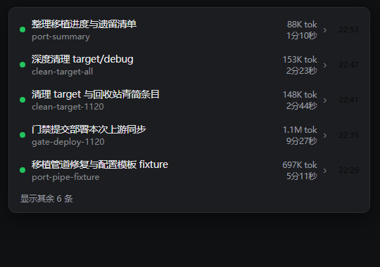

# DSH 插件与配置（dsh-plugins）

面向 [DeepSeek Harness](https://github.com/deepseek-ai/deepseek-harness)（DSH）的**插件与配置优化集合**：自研客户端/宿主插件、可直接抄的 profile 配置示例、逐轮优化记录，以及一个可选的主/子代理分层预设。

> 兼容性：已在 **DSH 0.2.2-rc.5**（Windows / desktop profile）上验证；每个插件目录带自测脚本，DSH 升级后建议重跑一遍。




## 包含什么

```
.
├─ plugins/                     自研 DSH 插件源码（file: 方式安装）
│  ├─ dsh-turn-tps/             本轮 tok/s 药丸、用量面板、任务总用时、每轮模型标签
│  ├─ dsh-subagent-running-count/  胶囊只显示运行中子智能体数；花名册创建时间/排序/折叠
│  ├─ dsh-session-model/        会话头部显示当前模型（主会话 + 子智能体会话）
│  ├─ dsh-todo-finalizer/       正常完成的回合自动收尾任务面板（不再挂旧状态）
│  └─ dsh-hide-completed-subagents/  隐藏已完成行（已被上一个取代，留档）
├─ extras/                      可选的配置与工具
│  ├─ planner-executor/         主 pro 规划 / 子 flash 执行的 agent 预设
│  ├─ launcher/                 Windows 一键启停脚本（dsh web）
│  ├─ credentials.example.yaml  凭据模板
│  └─ profile-examples.md       统计页 / 会话全文搜索 / 免费联网搜索等配置片段
├─ docs/                        优化记录、可优化项目清单、雷达增量、截图
├─ tools/                       小工具（radar 增量刷新脚本）
└─ AGENTS.md                    本仓库给 agent 的工作约定
```

## 插件安装

```powershell
# 换成你的 profile：desktop / web
dsh plugin --profile desktop add "file:<本仓库路径>\plugins\dsh-turn-tps"
# 插件源码改动后必须 remove + add 才会更新安装副本
dsh plugin --profile desktop remove dsh-turn-tps
dsh plugin --profile desktop add "file:<本仓库路径>\plugins\dsh-turn-tps"
```

装完**重启 DSH**（客户端插件在重启后刷新页面即可）。每个插件的 README 里写了具体功能、实现方式与测试方法。

## 配置示例（extras/profile-examples.md）

| 能力 | 做法 |
|---|---|
| 对话页「统计」标签页（TPS / Token / 缓存 / 模型用时） | 启用 DSH 自带实验包 `@deepseek-ai/dsh-experimental-client-ui-stats` |
| 历史会话**全文搜索**（FTS5） | 覆盖 `session-query-sqlite` 为持久化 SQLite，`openAt: first-search` |
| 免费联网搜索（修 `web_search` 401） | 安装 `@liustack/modsearch` |
| 关闭 flash 预设的计划模式组件 | profile 补丁 `disabled: true` |
| 主 pro 规划 / 子 flash 执行 | `extras/planner-executor` 预设 |

## 文档

- [优化记录](docs/DSH-优化记录-20261020.md)：逐轮「现象 / 根因 / 改动 / 验证」
- [可优化项目清单](docs/DSH可优化项目清单-20261120.md) / [雷达增量-最新](docs/DSH雷达增量-最新.md)
- [DSH 统计面板说明](docs/DSH统计面板-推荐说明.md)

## 开发与测试

```powershell
node --check plugins/dsh-turn-tps/src/client.js
node plugins/dsh-todo-finalizer/test/finalizer.mjs          # 纯 Node 单测
node plugins/dsh-turn-tps/test/footer-time.mjs              # 生成测试页
chrome --headless=new --dump-dom file:///<测试页>           # 浏览器断言
```

测试页镜像真实 DOM 结构（含 React fiber 数据），不是自造的简化页。

## 致谢与许可

- 灵感与部分配置参考：[`codesimplebird/dsh-all-in-one`](https://github.com/codesimplebird/dsh-all-in-one)（MIT）
- 免费搜索：`@liustack/modsearch`；额度面板：`@ychris12138/dsh-usage-stats`
- 本项目 [MIT](LICENSE)
